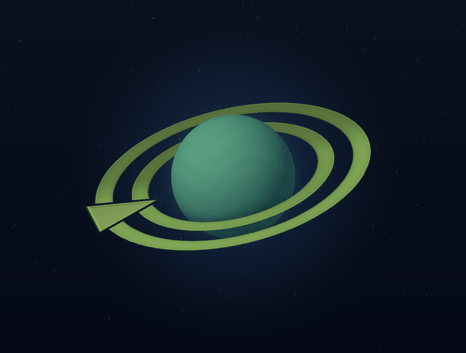

## Installation

### Debian / Ubuntu

Install Plymouth:

```bash
sudo apt install plymouth plymouth-themes
```

Clone and install the theme:

```bash
git clone https://github.com/keremsoke/orbit-plane-plymouth.git
cd orbit-plane-plymouth

sudo cp -r orbit-plane /usr/share/plymouth/themes/
```

Select the theme:

```bash
sudo plymouth-set-default-theme orbit-plane
sudo update-initramfs -u
```

If `plymouth-set-default-theme` is unavailable, register the theme with `update-alternatives` and select it.

### Customization

The animation is generated procedurally using Python and Pillow.

```bash
sudo apt install python3-pil
python3 generate_frames.py
```

The renderer should allow customization of the planet, ring geometry, lighting, triangle, and animation speed.